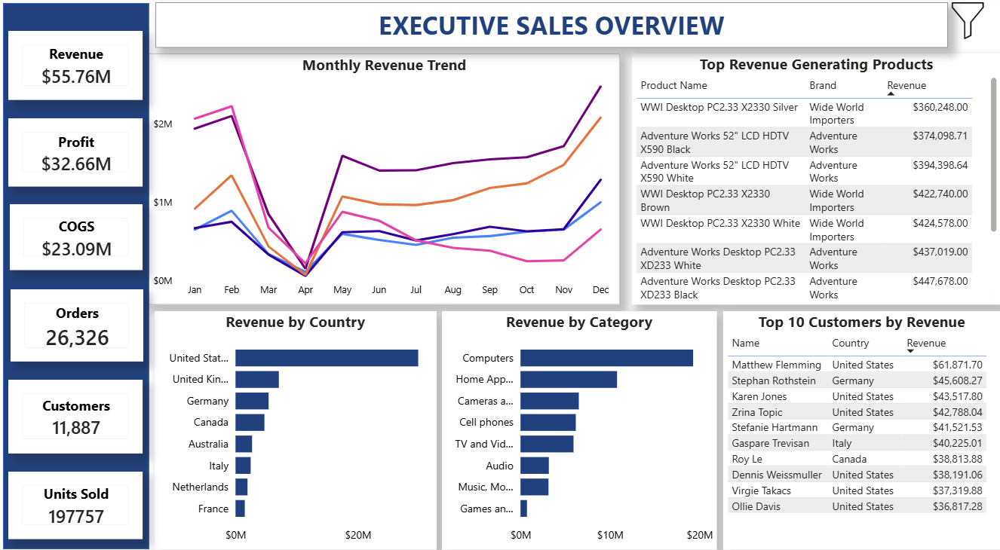
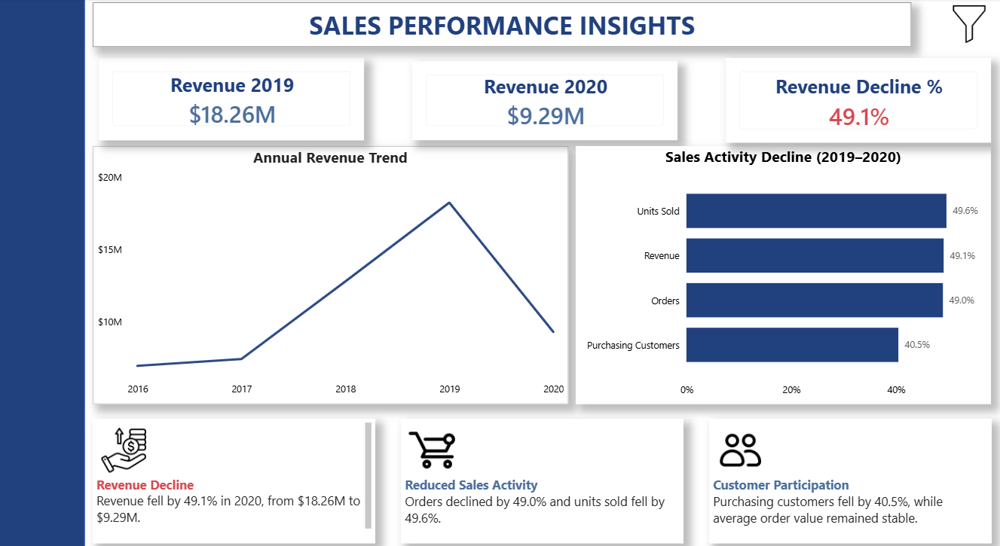
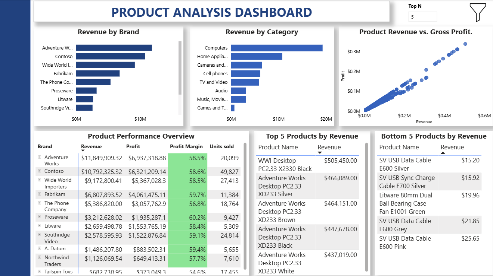
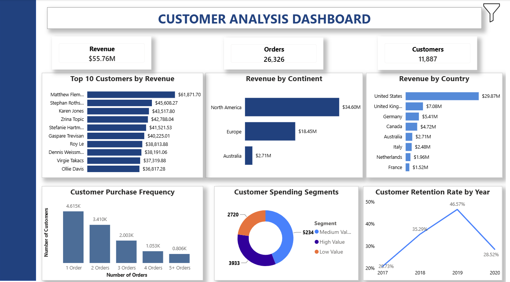
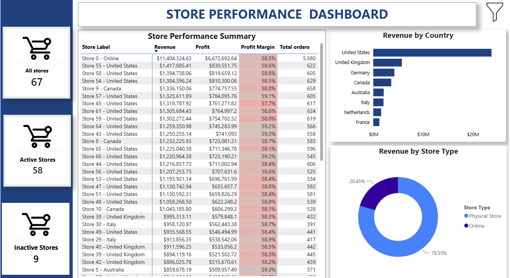
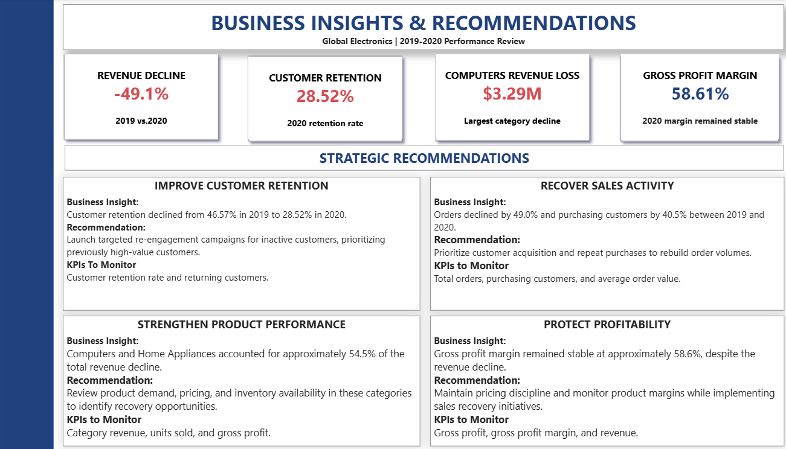

Global Electronics Store | Sales Performance & Growth Analysis

Project Overview

This project analyzes historical sales data from Global Electronics Store using Microsoft Power BI.

The objective was to evaluate sales performance, understand customer purchasing behavior, assess product and store profitability, and identify opportunities for business improvement.

The dataset covers **2016 through February 2021**, with particular attention to the revenue decline between 2019 and 2020.

The final deliverable is an interactive Power BI report that combines business performance monitoring with strategic recommendations.

Dashboard Screenshots

1. Project Cover

2. Executive Sales Overview

3. Sales Performance Insights

4. Product Analysis

 5. Customer Analysis

6. Store Performance

7. Business Insights & Recommendations

Business Problem

Global Electronics experienced a significant decline in revenue in 2020 following several years of growth.

The analysis focused on answering five questions:

1. How did revenue and profitability change over time?
2. Which product categories and markets contributed most to the decline?
3. How did customer purchasing behavior and retention change?
4. Which products and stores performed best?
5. What actions could help improve business performance?

Tools and Technologies

- Power BI Desktop: Data modeling, analysis, and dashboard development
- Power Query: Data cleaning and transformation
- DAX: Measures, KPIs, rankings, and time-based calculations
- Power BI Service: Report publishing and interactive testing

Dashboard Pages

1. Executive Sales Overview

Provides a high-level view of overall business performance.

Key metrics include:

- Total Revenue: $55.76M
- Gross Profit: $32.66M
- Total Orders: 26,326
- Purchasing Customers: 11,887
- Units Sold: 197,757

Includes revenue trends, geographic performance, product rankings, and interactive filters.

2. Sales Performance Insights

Examines changes in revenue and purchasing activity between 2019 and 2020.

The analysis compares revenue, orders, units sold, and purchasing customers to understand the scale and composition of the decline.

3. Product Analysis

Evaluates product and category performance using revenue, gross profit, and profit margin.

Features include:

- Revenue by brand and category
- Product revenue versus gross profit scatter chart
- Dynamic Top N and Bottom N product rankings
- Product profitability matrix

4. Customer Analysis

Examines customer purchasing behavior and retention.

Includes:

- Top customers by revenue
- Customer geographic distribution
- Purchase frequency
- Customer spending segments
- Customer retention trends
- Dynamic customer rankings

5. Store Performance

Compares store performance across markets and store types.

The dataset contains 67 stores, of which 58 recorded sales and 9 recorded no sales during the analyzed period.

6. Business Insights & Recommendations

Summarizes the most important findings and connects them to recommended business actions and measurable KPIs.

Key Findings

| Metric | Finding |
|---|---|
| Revenue | Declined 49.1% from 2019 to 2020 |
| Orders | Declined 49.0% |
| Purchasing Customers | Declined 40.5% |
| Customer Retention | Fell from 46.57% to 28.52% |
| Product Categories | Computers and Home Appliances accounted for approximately 54.5% of the revenue decline |
| Gross Profit Margin | Remained stable at approximately 58.6% |

Interpretation

The decline in revenue was closely associated with reduced order volumes and fewer purchasing customers, while average order value remained relatively stable.

Customer retention also weakened significantly.

Although gross profit decreased in absolute terms, gross profit margin remained stable. This suggests that rebuilding sales activity and customer participation should be central to recovery efforts.

The analysis identifies patterns and areas for investigation rather than establishing the external causes of the decline.

Business Recommendations

1. Improve Customer Retention

Re-engage inactive customers, particularly previously high-value customers.

Monitor customer retention rate and returning customer counts.

2. Recover Sales Activity

Develop initiatives aimed at increasing purchasing customer activity and repeat orders.

Monitor total orders, purchasing customers, and average order value.

3. Strengthen Product Performance

Investigate demand, pricing, and inventory availability in Computers and Home Appliances.

Monitor category revenue, units sold, and gross profit.

4. Protect Profitability

Monitor product-level margins while implementing sales recovery initiatives.

Track gross profit, gross profit margin, and revenue.

Technical Skills Demonstrated

- Data cleaning and transformation
- Data modeling and table relationships
- DAX measure development
- Time-based performance analysis
- Dynamic Top N and Bottom N rankings
- Customer segmentation and retention analysis
- Interactive slicers and bookmarks
- Report navigation
- Business insight generation
- Data storytelling

Project Files

- `Global_Electronics_Analysis.pbix` — Power BI report
- `README.md` — Project documentation
- `screenshots/` — Dashboard screenshots
- `data/` — Dataset or permitted sample data, where redistribution is authorized

Conclusion

This project demonstrates how Power BI can be used to transform transactional sales data into business insights.

The analysis identified changes in revenue, customer participation, product performance, and profitability, and translated those findings into practical recommendations.

It strengthened my skills in data modeling, DAX, dashboard design, and communicating analytical results to business stakeholders.

Dashboard Access

Live Report: https://app.powerbi.com/groups/me/reports/c473a914-0ade-48ad-93ad-8127c011d869/e7f8550b7a94a990838b?experience=power-bi

Author: Mercy Nduku

Tools: Power BI, Power Query, DAX
